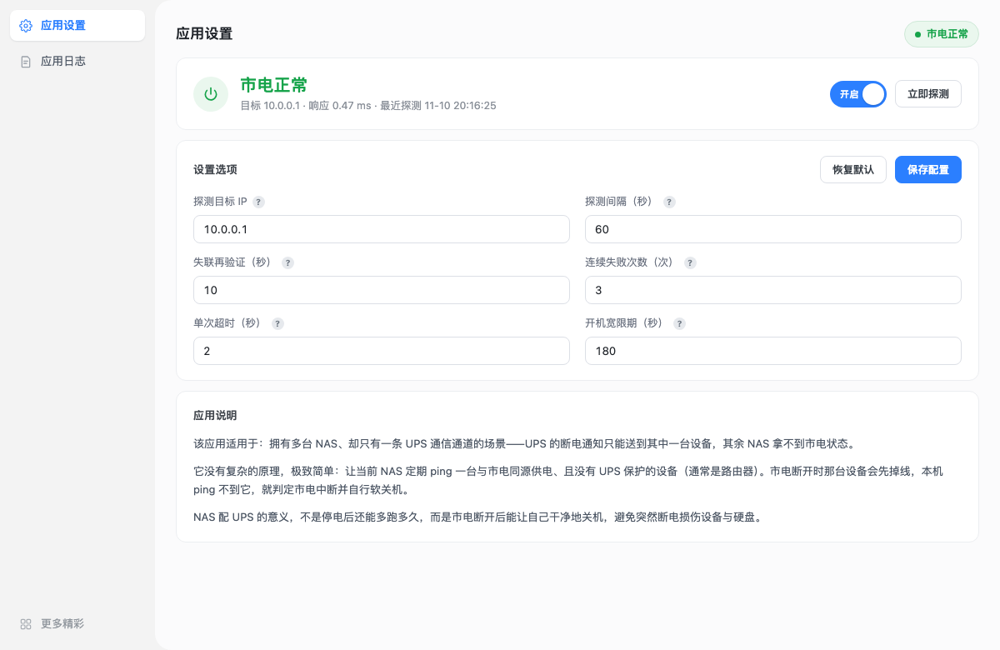
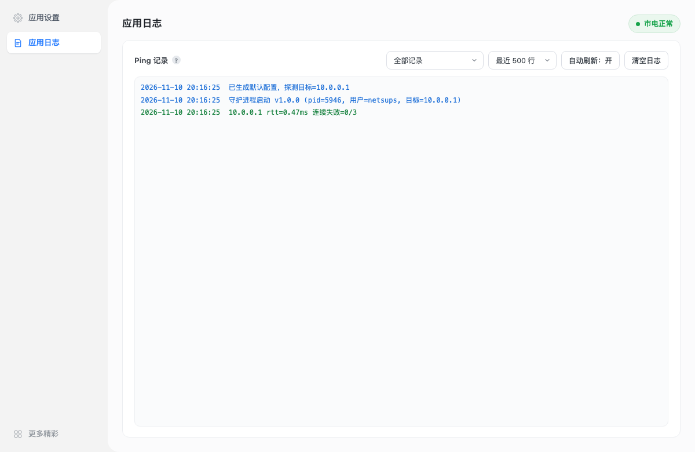

# 网络UPS · Network UPS for TerraMaster TOS 7

家里只有一条 UPS 通信线，却有好几台 NAS —— UPS 的断电通知只能送到其中一台，其余 NAS 对市电状态一无所知。

这个应用解决的就是这件事：让拿不到 UPS 通知的 NAS 去 ping 一台「与市电同源供电」的设备（通常是路由器）。
市电一断，那台设备先掉线，NAS 立刻就能察觉，然后自己安全关机，避免突然断电损伤设备和硬盘。

NAS 配 UPS 的意义，从来不是停电后还能多跑多久，而是市电断开时能让自己干净地关机。

- 平台：TerraMaster **TOS 7**（Deb 应用，桌面内嵌 WebUI）
- 架构：**x86_64** / **aarch64** 分别打包
- 依赖：只有 Python 3 标准库，无第三方包、无编译产物、不占任何 TCP 端口



---

## 工作原理

```
① 探测目标 IP          ← 与市电同源供电的设备（路由器）
        │
        ▼
② 探测间隔             ── ping 通 ──→ 只记一行日志，等下一个间隔
        │
        │ ping 不通
        ▼
③ 失联再验证           ── 不再按探测间隔，改按更密的节奏连续重测
        │
        ▼
④ 连续失败次数         ── 累计到阈值 ──→ 判定市电中断，安排本机安全关机
        │
        └─ 中途 ping 通了 → 计数清零，回到 ②
```

两个辅助参数：

- **单次超时**：一次 ping 最多等几秒回包，超时即算这一次「不通」
- **开机宽限期**：系统刚启动那段时间网络可能还没就绪，期间的失败不计数，避免刚开机就误关机

### 两个容易被忽略的细节

**宽限期只认系统开机时长**（`/proc/uptime`），不认应用进程启动时间。
重启服务、升级、改配置都不会重新计时 —— 否则每重启一次就等于把停电保护静默关掉几分钟。

**「不通」和「探测失败」是两件事。** `ping` 的退出码 `1` 才算目标无回应、才计数；
退出码 `2`（命令缺失、权限异常、域名解析失败等）一律不计数，界面会亮橙色「探测异常」。
把工具故障当成停电去关机，比不关机更糟。

---

## 安装

### 应用中心（推荐）

从 [Releases](https://github.com/HUiTHEME/NetUPS/releases) 下载对应架构的包，在 TOS 桌面
**应用中心 → 安装应用** 上传即可。安装后桌面会出现「网络UPS」图标。

- x86 机型：`netsups_x86_64.deb`
- ARM 机型：`netsups_aarch64.deb`

### 命令行（调试用）

```bash
sudo dpkg -i netsups_x86_64.deb
systemctl status netsups
```

命令行安装只会起后端；`/netsups/` 页面的路由需要应用中心注册，正常使用请走应用中心。

### 卸载

```bash
sudo dpkg --purge netsups
```

会移除服务、unit、socket、polkit 策略、前端资源，以及 `data/`（配置）与 `logs/`（日志），
不留残余文件；`purge` 还会删除 `netsups` 账号。

> 升级（`dpkg -i` 覆盖安装）不受影响：`postrm` 只在 `remove` / `purge` 时清数据，
> `upgrade` 分支只清可重建的运行期残留，配置与日志原样保留。

---

## 使用

安装后打开应用，填一个目标 IP 就能用。默认配置：

| 参数 | 默认值 | 说明 |
|---|---|---|
| 探测目标 IP | 自动取默认网关 | 必须与市电同源供电，不要选带 UPS 或独立供电的设备 |
| 探测间隔 | 60 秒 | ping 通时只记日志 |
| 失联再验证 | 10 秒 | ping 不通后改按这个节奏密集重测 |
| 连续失败次数 | 3 次 | 密集重测连续失败到此数即关机（默认约 30 秒判定） |
| 单次超时 | 2 秒 | 单个 ping 包等待上限 |
| 开机宽限期 | 180 秒 | 系统启动后这段时间内失败不计数，填 0 关闭 |

「应用日志」页可查看每一次探测的结果、事件与触发记录，也可切到「仅异常」快速定位。



### 排障

```bash
systemctl status netsups
journalctl -u netsups -f

# 直接打后端（不经平台）
curl -s --unix-socket /var/api/netsups.sock http://localhost/api/status | python3 -m json.tool

# 一次性诊断，不影响正在运行的服务
sudo -u netsups /usr/local/netsups/bin/netsups --check
sudo -u netsups /usr/local/netsups/bin/netsups --detect-gateway

# 关机授权是否就绪（只读查询，不会真的关机）
sudo -u netsups pkcheck --action-id org.freedesktop.login1.power-off --process $$
```

---

## 构建

```bash
python3 build.py          # 或 ./build.sh
```

产物：

```
dist/netsups_x86_64.deb     # Architecture: amd64   config.ini: x86_64
dist/netsups_aarch64.deb    # Architecture: arm64   config.ini: aarch64
```

**不需要交叉编译工具链**：载荷是纯 Python + 静态文件，两个架构字节一致，只有
`DEBIAN/control` 的 `Architecture` 和 `config.ini` 的 `platform` 不同，所以一台 x86
机器就能同时出两个包。构建脚本不依赖 `dpkg-deb`，macOS / Linux 都能跑。

脚本会自动处理 TOS 规范的硬性要求：所有文本文件转 LF、元数据放在 `usr/local/<id>/` 下、
目录 0755 / 文件 0644 / 启动器 0755、固定 mtime 保证可重现、剔除 `.DS_Store` 与 `._*`。

**tar 载荷用 GNU 格式**（审核项 T02）：TOS 的静态检查要求 `data.tar` / `control.tar`
不得是 USTAR(POSIX) 或 PAX 格式，Python 的 `tarfile.USTAR_FORMAT` 恰好会被判为违规。
`build.py` 统一用 `tarfile.GNU_FORMAT`，与 `dpkg-deb` 自己出的包一致（magic 为 `ustar  \0`）。

### 目录结构

```
├── VERSION                     # 版本号唯一来源，构建时注入 config.ini 与 control
├── PRIVACY.md                  # 隐私政策（仓库页面可见，同时打进包内）
├── build.py                    # 打包脚本
├── docs/screenshots/
└── src/
    ├── DEBIAN/                 # postinst / prerm / postrm / control 模板
    └── usr/local/netsups/
        ├── config.ini.in       # 应用清单（TOS 的 config.ini 实际是 JSON）
        ├── netsups.lang        # 26 段语言文件
        ├── netsups.env         # systemd EnvironmentFile
        ├── bin/netsups         # 启动器
        ├── init.d/netsups.service
        ├── images/icons/netsups.svg
        ├── server/
        │   ├── netsups.py      # unix socket HTTP + 探测调度 + 日志
        │   └── priv.py         # ping 与关机
        └── webui/index.html    # 前端（单文件，含 TOS 平台适配层）
```

前端源码会被压成 `webui.bz2` 打进包，安装时由 `postinst` 解压成 `webui/`，
与平台 nginx 的站点根约定一致。

---

## 设计与安全

**只监听 Unix Socket。** 后端监听 `/var/api/netsups.sock`（0660），前端由平台 nginx 从
`/usr/www/netsups` 发出，接口统一走 `/v2/proxy/netsups/`。不占任何 TCP 端口，不会与别的
应用抢端口，页面访问权限也交给平台管理。

**ping 不需要特权。** TOS 7 的 `net.ipv4.ping_group_range` 对普通用户放开，
`iputils-ping` 直接可用 —— 不需要 `CAP_NET_RAW`、不需要 setuid、更不需要 root 助手。

**关机交给 systemd，不自己 reboot。** TOS 禁止应用以 root 运行；而关机必须走
`tnas-system-stop.service`（sync、卸载卷、响蜂鸣），自己调 `reboot(2)` 会跳过这些步骤，
对 NAS 是数据风险。所以安装时投放一条**动作级、用户级**的 polkit 策略：

```
/etc/polkit-1/localauthority/50-local.d/50-netsups.pkla
  Identity = unix-user:netsups
  Action   = org.freedesktop.login1.power-off / -multiple-sessions / -ignore-inhibit
  Result   = yes
```

只影响这一个用户的这三个关机动作，其余任何动作、任何其他用户都不受影响；删掉文件即完全撤销
（`postrm` 会删）。

**开机自启要绕一个坑。** `/usr/local/netsups` 是指向 `/Volume1/@apps/netsups` 的软链，
而数据卷由 `tnas-mntdata.service` 挂载、开机几秒后才就绪。如果 `/etc/systemd/system/netsups.service`
只做软链，systemd 在 `multi-user.target` 阶段读它就会拿到 ENOENT，只记一条
`Failed to open ...: No such file or directory` 便不再重试 —— 应用表现为「重启后不自启」。
所以安装脚本在 `/etc/systemd/system` 落的是**实体副本**（位于根文件系统，开机即读到），
再由 unit 里的 `After=tnas-mntdata.service` 与 `ExecStartPre` 的等待兜住卷挂载时序。

**服务全程非 root**，unit 里开了 `NoNewPrivileges` / `ProtectSystem=strict` /
`ProtectHome` / `RestrictSUIDSGID` 等加固项，`ReadWritePaths` 只放开 `data/`、`logs/`
与 `/var/api`。

---

## 权限声明

| Permission | Justification |
|---|---|
| User: `netsups`（专用系统用户） | 服务以非 root 身份隔离运行 |
| File System: `/usr/local/netsups/data` | 保存探测配置 |
| File System: `/usr/local/netsups/logs` | 保存探测日志 |
| File System: `/var/api/netsups.sock` | 平台代理所需的 Unix socket（0660） |
| Network: ICMP echo（`iputils-ping`，非 root） | 核心功能：探测目标设备是否在线 |
| System: `org.freedesktop.login1.power-off`（polkit） | 核心功能：判定市电中断后执行安全关机 |
| Port: 无 | 不监听任何 TCP 端口 |
| Shared Folder: None | 不读写用户共享文件夹 |

---

## 隐私政策

本应用不收集、不上传、不共享任何数据，配置与日志只存在本机，卸载时一并删除。
完整说明见 [PRIVACY.md](PRIVACY.md)（同时以 `/usr/local/netsups/PRIVACY.md` 打进安装包）。

---

## 运行时文件清单

| Path (relative to `/usr/local/netsups/data/` unless noted) | Purpose | Format | Created When | Growth Bound / Rotation | Lifecycle |
|---|---|---|---|---|---|
| `/usr/local/netsups/data/config.json` | 用户保存的探测配置 | JSON | 首次启动；每次保存配置时重写 | < 4 KB | Persistent — 跨重启、跨升级保留；卸载（remove/purge）时删除 |
| `/usr/local/netsups/logs/ping.log` | 每次探测结果与事件记录，界面「应用日志」读取此文件 | 纯文本，每行 `YYYY-MM-DD HH:MM:SS [TAG] msg` | 服务启动；每次探测追加 | 超过 2 MB 轮转为 `ping.log.1`；每小时清理 3 天前的行 | Persistent, rotated；卸载时删除 |
| `/usr/local/netsups/logs/ping.log.1` | 上一代日志（轮转备份） | 同上 | 主日志超过 2 MB 时 | 单个文件，2 MB 上限 | Regenerable — 可安全删除 |
| `/var/api/netsups.sock` | 平台代理用的 Unix socket | Unix socket，mode 0660 | 服务启动时（先删陈旧文件） | N/A | Removed before each start；`ExecStopPost` 兜底删除 |
| `/usr/local/netsups/data/`（创建者：`postinst`） | 运行时数据根 | Directory 0750 `netsups:allusers` | 安装/升级 | 仅含上面一个文件 | 卸载时删除 |
| `/usr/local/netsups/logs/`（创建者：`postinst`） | 日志根 | Directory 0750 `netsups:allusers` | 安装/升级 | 仅含上面两个文件 | 卸载时删除 |
| `/usr/local/netsups/webui/`（创建者：`postinst`） | 从 `webui.bz2` 解压出的前端静态页 | Directory 0755 | 安装/升级时解压 | 约 40 KB | Regenerable — 卸载时删除，重装重建 |
| `/usr/www/netsups`（符号链接，创建者：`postinst` / 应用中心） | 平台 nginx 的站点根 | Symlink → `/usr/local/netsups/webui` | 安装 | N/A | 卸载时删除 |
| `/etc/systemd/system/netsups.service`（创建者：`postinst`；应用目录里那份的实体副本） | 让 systemd 在开机早期就能读到 unit | systemd unit (INI) | 安装/升级 | 约 2 KB | 卸载时删除 |
| `/etc/polkit-1/localauthority/50-local.d/50-netsups.pkla`（创建者：`postinst`） | 关机授权策略 | polkit .pkla (INI) | 安装/升级 | 约 400 B | 卸载时删除 |
| `/usr/local/netsups/webui.bz2`（包内文件） | 前端压缩包，平台约定的固定名称 | bzip2 压缩的 tar（GNU 格式） | 随包安装 | 约 11 KB | 随包卸载：dpkg 删除 |
| `/usr/local/netsups/PRIVACY.md`（包内文件，源：仓库根 `PRIVACY.md`） | 隐私政策（审核项 C3），与仓库内那份内容一致 | Markdown (UTF-8) | 随包安装 | 约 5 KB | 随包卸载：dpkg 删除 |

本应用不写 `/tmp`，不碰用户共享文件夹。（`/var/api` 在 TOS 上指向 `/tmp/api`，
socket 位置由平台约定，非应用自选。）

---

## 资源占用

unit 声明的上限（TOS 工具类默认配额）：

```ini
MemoryMax=256M
CPUQuota=50%
LimitNOFILE=65536
LimitNPROC=256
```

实测（x86_64，60 秒间隔）：常驻内存约 12 MB，CPU 基本为 0，每分钟一个 `ping` 进程（毫秒级）。
磁盘：程序约 50 KB，`data/` < 4 KB，`logs/` 上限 4 MB。

---

## 已知限制

- **关机链路需在真机做一次断电演练**：`pkcheck` 对三个 `power-off` 动作均返回 allow，
  logind 也已实际受理过关机请求，但项目本身没有在真实停电场景里跑过全流程。
  建议上线前拔一次市电，确认日志出现「触发关机」与「已通过 systemctl 提交系统关机」。
- **aarch64 包未在 ARM 真机验证**：载荷与架构无关，差异仅 `Architecture` 字段，风险低但没实测。
- 若平台后续提供正式的关机 API，应改用它并撤掉 `.pkla` 授权。
